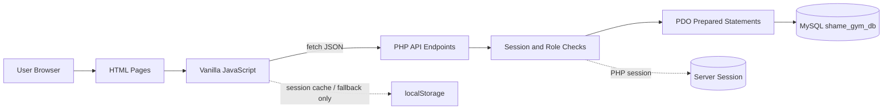
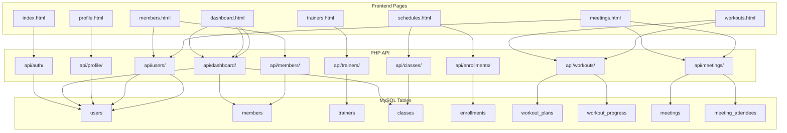
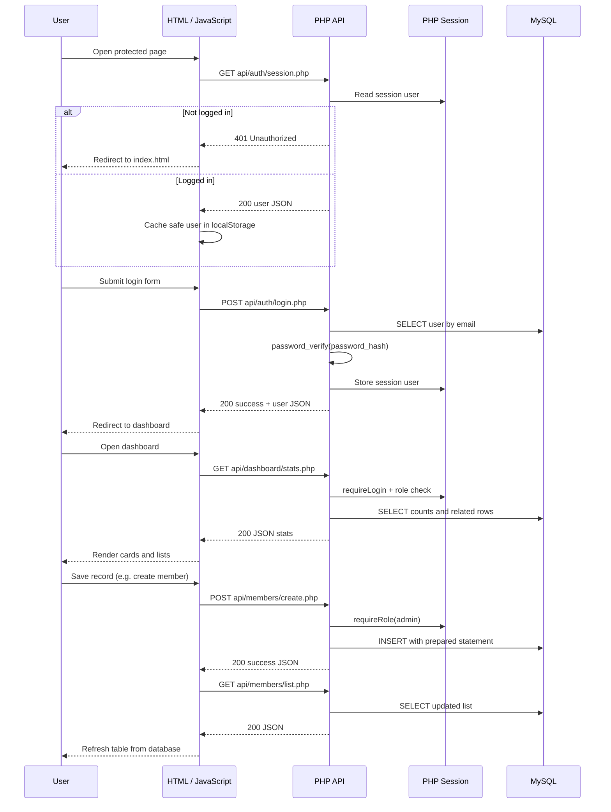
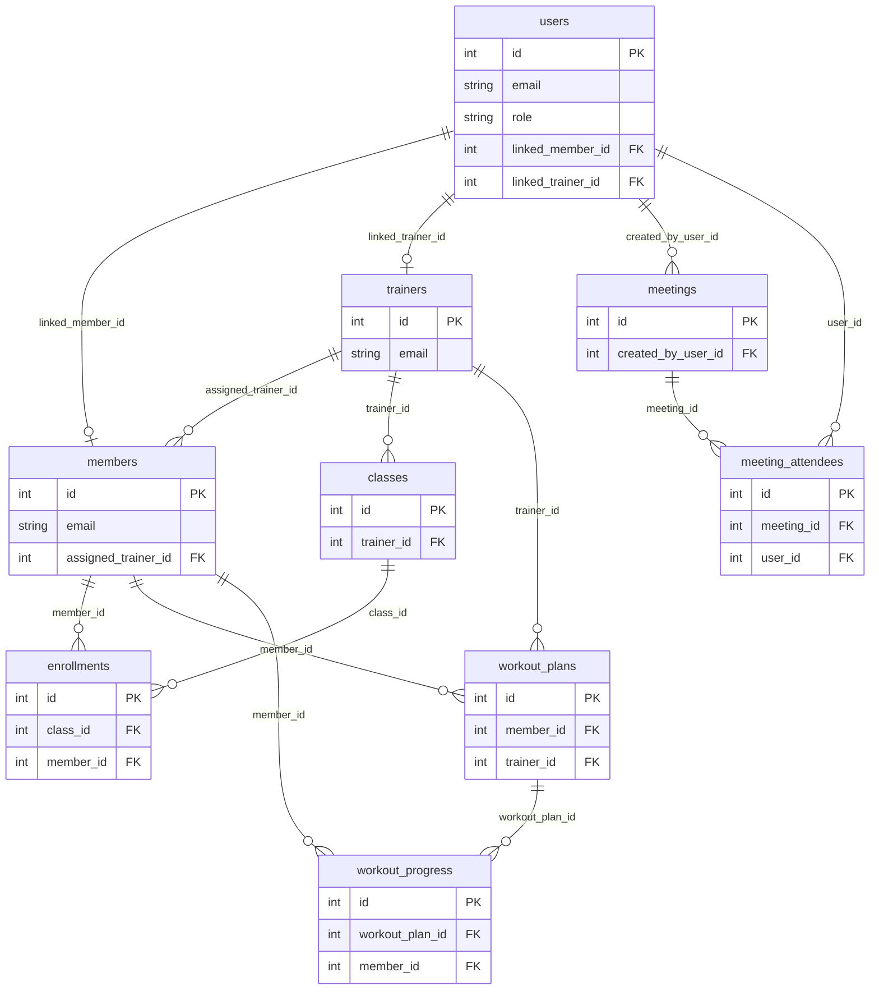
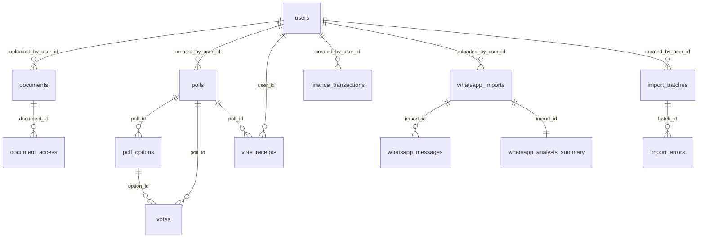

# S.H.A.M.E Gym — Organization Management System

**Strength · Health · Athletics · Motivation · Excellence**

A gym organization management web application for members, trainers, class schedules, enrollments, workout programs, staff meetings, and role-based dashboards. The application runs in the browser with a PHP + MySQL backend on XAMPP.

---

## Table of contents

1. [Project overview](#project-overview)
2. [Tech stack](#tech-stack)
3. [System architecture](#system-architecture)
4. [Core feature flow](#core-feature-flow)
5. [Login and API request flow](#login-and-api-request-flow)
6. [User roles and access](#user-roles-and-access)
7. [Data persistence](#data-persistence)
8. [Database setup](#database-setup)
9. [Database schema overview](#database-schema-overview)
10. [Database ER diagram](#database-er-diagram)
11. [Backend API structure](#backend-api-structure)
12. [Running the project locally](#running-the-project-locally)
13. [Demo accounts](#demo-accounts)
14. [Testing checklist](#testing-checklist)
15. [Security notes](#security-notes)
16. [Current scope and future expansion](#current-scope-and-future-expansion)
17. [Project structure](#project-structure)

---

## Project overview

S.H.A.M.E Gym is a software engineering course project that models day-to-day operations for a fitness organization. Staff and members share one MySQL database through JSON API endpoints.

| Area | What the system handles |
|------|-------------------------|
| People | Members, trainers, login accounts |
| Classes | Timetable, capacity, enrollment |
| Training | Workout plans and day progress |
| Operations | Staff meetings and attendees |
| Self-service | Profile edits and account activation |
| Reporting | Role-aware dashboard statistics |

---

## Tech stack

| Layer | Technology |
|-------|------------|
| Frontend | HTML, CSS (custom theme), Vanilla JavaScript |
| Backend | PHP (plain, no framework) |
| Database | MySQL / MariaDB |
| Local server | XAMPP (Apache + MySQL) |
| Database admin | phpMyAdmin |

Pages call JSON endpoints with `fetch()` and `credentials: "same-origin"`. There is no build step or frontend framework.

---

## System architecture

The diagram below shows how the browser, PHP API layer, and database work together. PHP sessions and role checks run on every protected request.



| Layer | Responsibility |
|-------|----------------|
| HTML pages | Layout, forms, tables, navigation shell |
| JavaScript | Render UI, call APIs, enforce page-level access |
| PHP APIs | Authenticate, validate input, query database, return JSON |
| MySQL | Persistent storage for all application records |
| localStorage | Session display cache, UI preferences, emergency fallback only |

---

## Core feature flow

Each visible module reads and writes through its API folder. The database tables on the right are the primary storage target.



**Module distinction**

| Module | Purpose |
|--------|---------|
| Schedules | Group fitness classes that members enroll in |
| Workouts | Personal training programs with daily progress |
| Meetings | Internal staff coordination (admin only) |

---

## Login and API request flow



---

## User roles and access

Page navigation and API endpoints both enforce the same role rules.

| Feature | Admin | Trainer | Member |
|---------|-------|---------|--------|
| Dashboard | Full access | Full access | Full access |
| Members | Full access | View assigned only | No access |
| Trainers | Full access | No access | No access |
| Schedules (classes) | Full access | View own classes | View and enroll |
| Enrollments | Manage rosters | View own rosters | Own enrollments |
| Profile | No access | No access | Own data |
| Workout plans | Full access | Manage assigned | View own |
| Workout progress | Full access | View assigned | Update own |
| Meetings | Full access | No access | No access |
| Account activation | Yes | Yes | Yes |

**Role summaries**

| Role | Typical tasks |
|------|---------------|
| **Admin** | Manage members, trainers, classes, workouts, and staff meetings; view organization stats |
| **Trainer** | View assigned members, create workout plans, view own class rosters |
| **Member** | Enroll in classes, follow workout program, edit own profile |

---

## Data persistence

| Storage | Role |
|---------|------|
| **MySQL (`shame_gym_db`)** | Primary source of truth for all application records |
| **PHP APIs** | Validate sessions, enforce roles, read/write database with PDO |
| **PHP session** | Server-side authentication state |
| **localStorage** | Not the primary database |

localStorage is used only for:

- A non-sensitive session cache mirrored from the server (`shame_session`)
- UI preferences (for example splash screen skip)
- Seed/bootstrap data on first load
- Emergency fallback when the API is unreachable

Normal create, update, delete, and list operations go through PHP and MySQL.

---

## Database setup

### Prerequisites

1. Install [XAMPP](https://www.apachefriends.org/) with Apache and MySQL running.
2. Place the project in your web root:
   ```
   /Applications/XAMPP/xamppfiles/htdocs/shame-gym
   ```

### Create database and load data

**Terminal**

```bash
/Applications/XAMPP/xamppfiles/bin/mysql -uroot < database/schema.sql
/Applications/XAMPP/xamppfiles/bin/mysql -uroot < database/seed.sql
```

**phpMyAdmin**

1. Open http://localhost/phpmyadmin
2. Import `database/schema.sql`
3. Import `database/seed.sql`

This creates **`shame_gym_db`** with foreign keys and demo data. Connection settings are in `api/config/database.php` (default: `localhost`, user `root`, empty password).

---

## Database schema overview

### Authentication and accounts

| Table | Purpose |
|-------|---------|
| `users` | Login accounts with `password_hash`, role, and links to member/trainer profiles |

### Core gym management

| Table | Purpose |
|-------|---------|
| `members` | Member profiles, membership type, assigned trainer |
| `trainers` | Trainer profiles and specialization |
| `classes` | Scheduled group fitness sessions |
| `enrollments` | Member sign-ups for classes |

### Workout management

| Table | Purpose |
|-------|---------|
| `workout_plans` | Trainer-authored programs (`plan_details` JSON) |
| `workout_progress` | Completed workout days per plan |

### Staff meetings

| Table | Purpose |
|-------|---------|
| `meetings` | Staff meeting records |
| `meeting_attendees` | Invited staff (`user_id`, `attendee_email`) |

### Prepared future extensions (no UI yet)

| Table | Purpose |
|-------|---------|
| `documents` | Uploaded document metadata |
| `document_access` | Role-based document visibility |
| `polls` | Organization ballots |
| `poll_options` | Poll answer choices |
| `votes` | Anonymous ballot selections |
| `vote_receipts` | Duplicate-vote prevention |
| `finance_transactions` | Income and expense ledger |
| `whatsapp_imports` | WhatsApp export upload batches |
| `whatsapp_messages` | Parsed chat messages |
| `whatsapp_analysis_summary` | Precomputed chat analytics |
| `import_batches` | Bulk legacy import tracking |
| `import_errors` | Rejected import rows |

---

## Database ER diagram

Core tables used by the visible application. Foreign key column names match `database/schema.sql`.



### Prepared extension tables (schema only)

These tables exist in the schema but are not connected to visible pages today.



---

## Backend API structure

All endpoints return JSON. Protected routes require a valid PHP session cookie.

| API folder | Purpose | Main tables |
|------------|---------|-------------|
| `api/auth/` | Login, logout, session check, account activation | `users` |
| `api/dashboard/` | Role-aware dashboard statistics | `members`, `trainers`, `classes`, `enrollments`, `workout_plans`, `meetings` |
| `api/profile/` | Current user profile read/update | `users`, `members`, `trainers` |
| `api/members/` | Member list, get, create, update, soft delete | `members`, `users` |
| `api/trainers/` | Trainer list, get, create, update, soft delete | `trainers`, `users` |
| `api/classes/` | Class schedule list, get, create, update, cancel | `classes` |
| `api/enrollments/` | Enrollment list, enroll, unenroll | `enrollments` |
| `api/workouts/` | Workout plans, progress, archive | `workout_plans`, `workout_progress` |
| `api/meetings/` | Staff meetings and attendee management | `meetings`, `meeting_attendees` |
| `api/users/` | Staff user list for meeting attendees; account provisioning | `users` |
| `api/config/` | Shared database, auth, request, and response helpers | — |

Shared PHP helpers include `requireLogin()`, `requireRole()`, `successResponse()`, `errorResponse()`, and PDO connection setup.

### Page to API mapping

| Feature | Page | Backend |
|---------|------|---------|
| Login / logout / session | `index.html` | `api/auth/*` |
| Account activation | `index.html` | `api/auth/activate.php` |
| Dashboard stats | `dashboard.html` | `api/dashboard/stats.php` |
| Member CRUD | `members.html` | `api/members/*` |
| Trainer CRUD | `trainers.html` | `api/trainers/*` |
| Class CRUD | `schedules.html` | `api/classes/*` |
| Enrollment | `schedules.html` | `api/enrollments/*` |
| Profile | `profile.html` | `api/profile/me.php` |
| Workouts | `workouts.html` | `api/workouts/*` |
| Meetings | `meetings.html` | `api/meetings/*`, `api/users/list.php` |

---

## Running the project locally

1. Start **Apache** and **MySQL** in the XAMPP control panel.
2. Import the database (see [Database setup](#database-setup)).
3. Open http://localhost/shame-gym/
4. Log in with a [demo account](#demo-accounts).
5. Optional: inspect data at http://localhost/phpmyadmin

Use `http://localhost/shame-gym/` (not `file://`) so PHP sessions and API calls work correctly.

---

## Demo accounts

Passwords match `database/seed.sql`.

### Admin — password: `admin123`

| Role | Email | Password |
|------|-------|----------|
| Admin | `admin@shame.gym` | `admin123` |

### Trainers — password: `trainer123`

| Role | Email | Password |
|------|-------|----------|
| Trainer | `trainer@shame.gym` | `trainer123` |
| Trainer | `marcus.hale@shame.gym` | `trainer123` |
| Trainer | `nadia.petrova@shame.gym` | `trainer123` |
| Trainer | `diego.santos@shame.gym` | `trainer123` |
| Trainer | `priya.anand@shame.gym` | `trainer123` |
| Trainer | `tyler.brooks@shame.gym` | `trainer123` |

### Members — password: `member123`

| Role | Email | Password |
|------|-------|----------|
| Member | `member@shame.gym` | `member123` |
| Member | `james.carter@email.com` | `member123` |
| Member | `sofia.romano@email.com` | `member123` |
| Member | `liam.novak@email.com` | `member123` |
| Member | `amara.okafor@email.com` | `member123` |
| Member | `daniel.reyes@email.com` | `member123` |
| Member | `elena.fischer@email.com` | `member123` |

### Pending activation demo

| Email | Notes |
|-------|-------|
| `pending.member@shame.gym` | No password in seed — use **Activate your account** on the login page |

---

## Testing checklist

- [ ] Log in as admin (`admin@shame.gym`)
- [ ] Create a new member and assign a trainer
- [ ] Create a new trainer and confirm they appear in the member trainer dropdown
- [ ] Complete account activation for a pending user
- [ ] Create a class on Schedules
- [ ] Log in as member and enroll in a class
- [ ] Open class roster and confirm enrolled member appears
- [ ] Edit profile as member (name / email / phone)
- [ ] Create a workout plan for a member
- [ ] Mark a workout day complete as that member
- [ ] Schedule a staff meeting with attendees (admin)
- [ ] Refresh each page and confirm data persists from MySQL

---

## Security notes

| Topic | Implementation |
|-------|----------------|
| Role-based access | Checked in JavaScript navigation and enforced again in every PHP API |
| PHP sessions | Authentication stored server-side; APIs are the authority |
| Prepared statements | All database queries use PDO prepared statements |
| Password storage | bcrypt hashes in `users.password_hash`; never returned in JSON |
| Account activation | New accounts can require password setup before login |
| Soft delete | Status fields (`inactive`, `cancelled`, `archived`) used where appropriate |

---

## Current scope and future expansion

The visible application covers authentication, members, trainers, schedules, enrollments, dashboard, profile, workouts, and staff meetings.

The database also includes prepared structures for documents, polls, finance, WhatsApp analytics, and bulk import tracking. These can be connected to additional UI pages in future work without changing the core architecture above.

---

## Project structure

```
shame-gym/
  index.html              Login and account activation
  dashboard.html          Role-aware home page
  members.html            Member management / trainer assigned view
  trainers.html           Trainer management
  schedules.html          Class timetable and enrollment
  workouts.html           Workout plans and member progress
  meetings.html           Staff meetings (admin)
  profile.html            Member profile self-edit

  css/                    Custom stylesheets
  js/                     Page logic and API integration
  api/                    PHP JSON endpoints
  database/
    schema.sql            Full MySQL schema
    seed.sql              Demo data
  assets/                 Logo and static images
```

| JavaScript file | Role |
|-----------------|------|
| `auth.js` | Login, session sync, permissions, sidebar |
| `data.js` | Seed data and emergency fallback helpers |
| `members.js`, `trainers.js`, `schedules.js` | CRUD pages |
| `enrollments.js` | Class enrollment logic |
| `workouts.js`, `meetings.js` | Workouts and meetings |
| `profile.js`, `dashboard.js` | Profile and dashboard |
| `toast.js`, `phone.js` | Notifications and phone input |

---

## License

Academic / demo project — see repository owner for usage terms.
