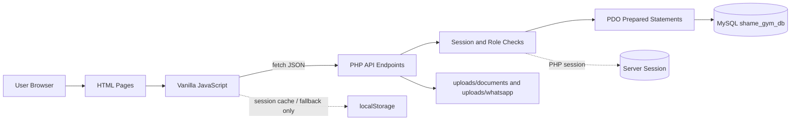
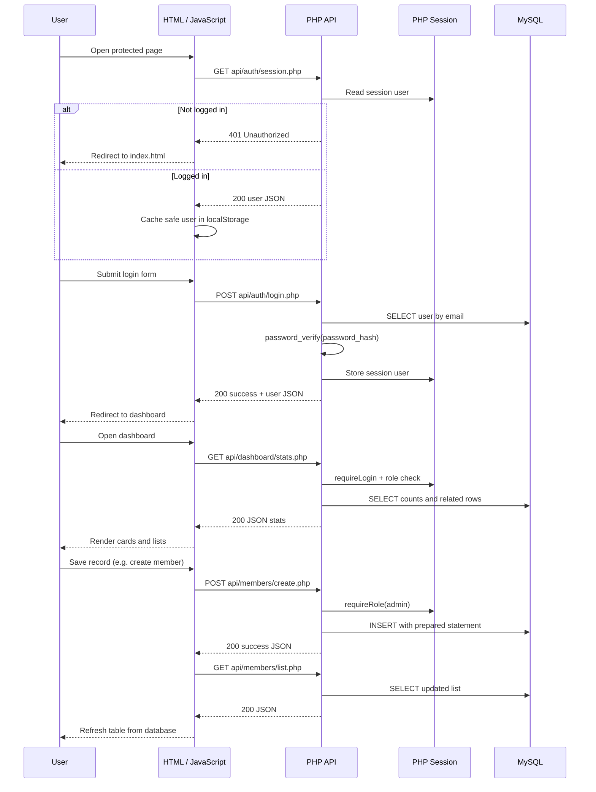
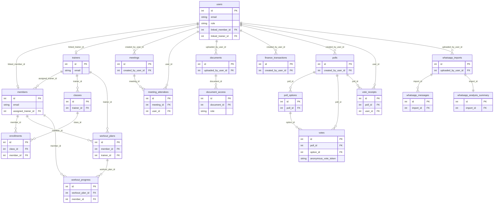
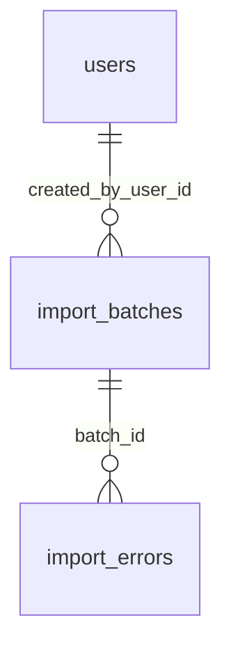

# S.H.A.M.E Gym — Organization Management System

**Strength · Health · Athletics · Motivation · Excellence**

A gym organization management web application backed by PHP, MySQL, and vanilla JavaScript on XAMPP. The system covers member and trainer management, class scheduling, enrollments, workouts, staff meetings, documents, finance, confidential polls, and WhatsApp chat export analysis.

---

## Table of contents

1. [Project overview](#project-overview)
2. [Tech stack](#tech-stack)
3. [System architecture](#system-architecture)
4. [Core feature flow](#core-feature-flow)
5. [Login and API request flow](#login-and-api-request-flow)
6. [User roles and access](#user-roles-and-access)
7. [Data persistence](#data-persistence)
8. [Database setup](#database-setup)
9. [Upload directory setup](#upload-directory-setup)
10. [Database schema overview](#database-schema-overview)
11. [Database ER diagram](#database-er-diagram)
12. [Backend API structure](#backend-api-structure)
13. [Running the project locally](#running-the-project-locally)
14. [Demo accounts](#demo-accounts)
15. [Testing checklist](#testing-checklist)
16. [Security notes](#security-notes)
17. [Future improvements](#future-improvements)
18. [Project structure](#project-structure)

---

## Project overview

S.H.A.M.E Gym is a software engineering course project that models day-to-day operations for a fitness organization. Staff and members share one MySQL database through JSON API endpoints.

| Area | What the system handles |
|------|-------------------------|
| Authentication | Login, logout, PHP sessions, account activation |
| People | Members, trainers, login accounts |
| Classes | Timetable, capacity, enrollment |
| Training | Workout plans and day progress |
| Operations | Staff meetings and attendees |
| Documents | Upload, search, role-based download |
| Finance | Income/expense ledger and summaries (admin) |
| Polls | Confidential voting with anonymous ballots |
| WhatsApp analysis | Import `.txt` chat exports and activity summaries (admin) |
| Legacy import | Bulk CSV member data import with validation and error logging (admin) |
| Self-service | Profile edits and account activation |
| Reporting | Role-aware dashboard statistics |

---

## Tech stack

| Layer | Technology |
|-------|------------|
| Frontend | HTML, CSS (custom theme), Vanilla JavaScript |
| Backend | PHP (plain, no framework) |
| Database | MySQL / MariaDB |
| Local server | XAMPP (Apache + MySQL) |
| Database admin | phpMyAdmin |

Pages call JSON endpoints with `fetch()` and `credentials: "same-origin"`. There is no build step or frontend framework.

---

## System architecture

The diagram below shows how the browser, PHP API layer, and database work together. PHP sessions and role checks run on every protected request.



| Layer | Responsibility |
|-------|----------------|
| HTML pages | Layout, forms, tables, navigation shell |
| JavaScript | Render UI, call APIs, enforce page-level access |
| PHP APIs | Authenticate, validate input, query database, return JSON |
| MySQL | Persistent storage for all application records |
| Upload folders | Stored document and WhatsApp export files on disk |
| localStorage | Session display cache, UI preferences, emergency fallback only |

---

## Core feature flow

Each visible module reads and writes through its API folder. The database tables on the right are the primary storage target.

```mermaid
flowchart TB
    subgraph Frontend["Frontend Pages"]
        AuthP[index.html]
        Dash[dashboard.html]
        Mem[members.html]
        Trn[trainers.html]
        Sch[schedules.html]
        Wkt[workouts.html]
        Mtg[meetings.html]
        Doc[documents.html]
        Fin[finance.html]
        Pol[polls.html]
        Wa[whatsapp.html]
        Leg[legacy-import.html]
        Prf[profile.html]
    end

    subgraph API["PHP API"]
        A1[api/auth/]
        A2[api/dashboard/]
        A3[api/members/]
        A4[api/trainers/]
        A5[api/classes/]
        A6[api/enrollments/]
        A7[api/workouts/]
        A8[api/meetings/]
        A9[api/documents/]
        A10[api/finance/]
        A11[api/polls/]
        A12[api/whatsapp/]
        A15[api/import/]
        A13[api/profile/]
        A14[api/users/]
    end

    subgraph DB["MySQL Tables"]
        T1[users]
        T2[members]
        T3[trainers]
        T4[classes]
        T5[enrollments]
        T6[workout_plans]
        T7[workout_progress]
        T8[meetings]
        T9[meeting_attendees]
        T10[documents]
        T11[document_access]
        T12[finance_transactions]
        T13[polls]
        T14[poll_options]
        T15[votes]
        T16[vote_receipts]
        T17[whatsapp_imports]
        T18[whatsapp_messages]
        T19[whatsapp_analysis_summary]
        T20[import_batches]
        T21[import_errors]
    end

    AuthP --> A1 --> T1
    Dash --> A2 --> T1
    Mem --> A3 --> T2
    Trn --> A4 --> T3
    Sch --> A5 --> T4
    Sch --> A6 --> T5
    Wkt --> A7 --> T6
    Wkt --> A7 --> T7
    Mtg --> A8 --> T8
    Mtg --> A8 --> T9
    Doc --> A9 --> T10
    Doc --> A9 --> T11
    Fin --> A10 --> T12
    Pol --> A11 --> T13
    Pol --> A11 --> T14
    Pol --> A11 --> T15
    Pol --> A11 --> T16
    Wa --> A12 --> T17
    Wa --> A12 --> T18
    Wa --> A12 --> T19
    Leg --> A15 --> T2
    Leg --> A15 --> T20
    Leg --> A15 --> T21
    Prf --> A13 --> T1
    Mem --> A14 --> T1
    Mtg --> A14 --> T1
```



**Module distinction**

| Module | Purpose |
|--------|---------|
| Schedules | Group fitness classes that members enroll in |
| Workouts | Personal training programs with daily progress |
| Meetings | Internal staff coordination (admin only) |
| Documents | Shared files with role-based access rules |
| Finance | Organization income and expense tracking (admin only) |
| Polls | Confidential organization ballots and admin CSV results export |
| WhatsApp | Parsed chat export analytics (admin only; no WhatsApp API) |
| Legacy import | CSV preview/import for ~4000 legacy member records (admin only; no login accounts created) |

---

## Login and API request flow



---

## User roles and access

Page navigation and API endpoints both enforce the same role rules.

| Feature | Admin | Trainer | Member |
|---------|-------|---------|--------|
| Dashboard | Full access | Full access | Full access |
| Members | Full access | View assigned only | No access |
| Trainers | Full access | No access | No access |
| Schedules (classes) | Full access | View own classes | View and enroll |
| Enrollments | Manage rosters | View own rosters | Own enrollments |
| Profile page | No access | No access | Own data |
| Workout plans | Full access | Manage assigned | View own |
| Workout progress | Full access | View assigned | Update own |
| Meetings | Full access | No access | No access |
| Documents | Upload, edit, archive, download | View/download allowed docs | View/download allowed docs |
| Finance | Full access | No access | No access |
| Polls | Create, close, results, CSV export | Vote once, view allowed results | Vote once, view allowed results |
| WhatsApp analysis | Full access | No access | No access |
| Legacy import | Preview and import CSV member records | No access | No access |
| Account activation | Yes | Yes | Yes |

**Role summaries**

| Role | Typical tasks |
|------|---------------|
| **Admin** | Manage members, trainers, classes, workouts, meetings, documents, finance, polls, WhatsApp imports, and legacy CSV imports |
| **Trainer** | View assigned members, create workout plans, view class rosters, vote in polls, download shared documents |
| **Member** | Enroll in classes, follow workout program, edit own profile, vote in polls, download shared documents |

---

## Data persistence

| Storage | Role |
|---------|------|
| **MySQL (`shame_gym_db`)** | Primary source of truth for all application records |
| **PHP APIs** | Validate sessions, enforce roles, read/write database with PDO |
| **PHP session** | Server-side authentication state |
| **Upload folders** | Document files, WhatsApp export files, and stored legacy CSV imports on disk |
| **localStorage** | Not the primary database |

localStorage is used only for:

- A non-sensitive session cache mirrored from the server (`shame_session`)
- UI preferences (for example splash screen skip)
- Seed/bootstrap data on first load
- Emergency fallback when the API is unreachable

Documents, finance, polls, WhatsApp, and legacy import modules are API-first and do not persist data in localStorage.

Normal create, update, delete, and list operations go through PHP and MySQL.

---

## Database setup

### Prerequisites

1. Install [XAMPP](https://www.apachefriends.org/) with Apache and MySQL running.
2. Place the project in your web root:
   ```
   /Applications/XAMPP/xamppfiles/htdocs/shame-gym
   ```

### Create database and load data

**Terminal**

```bash
/Applications/XAMPP/xamppfiles/bin/mysql -uroot < database/schema.sql
/Applications/XAMPP/xamppfiles/bin/mysql -uroot < database/seed.sql
```

**phpMyAdmin**

1. Open http://localhost/phpmyadmin
2. Import `database/schema.sql`
3. Import `database/seed.sql`

This creates **`shame_gym_db`** with foreign keys and demo data. Connection settings are in `api/config/database.php` (default: `localhost`, user `root`, empty password).

---

## Upload directory setup

Document uploads and WhatsApp imports store files on disk under:

```
uploads/documents/
uploads/whatsapp/
uploads/import/
```

Create the folders and make them writable by the Apache user on local XAMPP:

```bash
mkdir -p uploads/documents uploads/whatsapp uploads/import
chmod 0777 uploads/documents uploads/whatsapp uploads/import
```

Notes:

- Three seed demo document files are included in the repository so document download works immediately after setup:
  - `uploads/documents/doc_001_member_handbook.pdf`
  - `uploads/documents/doc_002_trainer_safety.pdf`
  - `uploads/documents/doc_003_finance_template.xlsx`
- These are safe demo files for testing document download only.
- Runtime uploaded files must not be committed. `.gitignore` excludes files under `uploads/documents/`, `uploads/whatsapp/`, and `uploads/import/` while allowing these three seed demo documents and `.gitkeep` placeholders.
- On macOS XAMPP, Apache typically runs as the `daemon` user and needs write permission on these folders
- Document uploads accept PDF, DOC, DOCX, TXT, PNG, JPG, and JPEG (max 10 MB)
- WhatsApp imports accept `.txt` export files only (max 10 MB)
- Legacy CSV imports accept `.csv` files only (max 5 MB)
- This permission setup is intended for local XAMPP development

---

## Database schema overview

### Authentication and accounts

| Table | Purpose |
|-------|---------|
| `users` | Login accounts with `password_hash`, role, and links to member/trainer profiles |

### Core gym management

| Table | Purpose |
|-------|---------|
| `members` | Member profiles, membership type, assigned trainer |
| `trainers` | Trainer profiles and specialization |
| `classes` | Scheduled group fitness sessions |
| `enrollments` | Member sign-ups for classes |

### Workout management

| Table | Purpose |
|-------|---------|
| `workout_plans` | Trainer-authored programs (`plan_details` JSON) |
| `workout_progress` | Completed workout days per plan |

### Staff meetings

| Table | Purpose |
|-------|---------|
| `meetings` | Staff meeting records |
| `meeting_attendees` | Invited staff (`user_id`, `attendee_email`) |

### Document management

| Table | Purpose |
|-------|---------|
| `documents` | Uploaded document metadata and file paths |
| `document_access` | Role-based document visibility rules |

### Finance

| Table | Purpose |
|-------|---------|
| `finance_transactions` | Income and expense ledger |

### Polls and confidential voting

| Table | Purpose |
|-------|---------|
| `polls` | Organization ballots |
| `poll_options` | Poll answer choices |
| `votes` | Anonymous ballot selections (`anonymous_vote_token`; no `user_id`) |
| `vote_receipts` | Duplicate-vote prevention only |

Poll result CSV exports (admin) set `generated_at` in **Europe/Berlin** local time. In summer this appears as **CEST**; in winter as **CET**. The export contains aggregate counts and percentages only. It does not expose voter identity, voter email, anonymous vote tokens, or receipt data.

### WhatsApp analysis

| Table | Purpose |
|-------|---------|
| `whatsapp_imports` | Uploaded WhatsApp `.txt` export batches |
| `whatsapp_messages` | Parsed chat messages |
| `whatsapp_analysis_summary` | Precomputed dashboard metrics per import |

### Legacy bulk import

| Table | Purpose |
|-------|---------|
| `import_batches` | Bulk legacy CSV import history and counts |
| `import_errors` | Rejected import rows with validation messages |

Sample CSV files for testing:

| File | Purpose |
|------|---------|
| `sample_data/legacy_members_4000_sample.csv` | 4000 valid synthetic member rows plus header |
| `sample_data/legacy_members_validation_sample.csv` | Mixed valid/invalid rows for preview and error logging demos |

Legacy import inserts cleaned rows into `members` only. It does **not** create login accounts in `users`.

---

## Database ER diagram

Core operational tables. Foreign key column names match `database/schema.sql`.



### Legacy import tables



---

## Backend API structure

All endpoints return JSON. Protected routes require a valid PHP session cookie.

| API folder | Purpose | Main tables |
|------------|---------|-------------|
| `api/auth/` | Login, logout, session check, account activation | `users` |
| `api/dashboard/` | Role-aware dashboard statistics | `members`, `trainers`, `classes`, `enrollments`, `workout_plans`, `meetings` |
| `api/profile/` | Current user profile read/update | `users`, `members`, `trainers` |
| `api/members/` | Member list, get, create, update, soft delete | `members`, `users` |
| `api/trainers/` | Trainer list, get, create, update, soft delete | `trainers`, `users` |
| `api/classes/` | Class schedule list, get, create, update, cancel | `classes` |
| `api/enrollments/` | Enrollment list, enroll, unenroll | `enrollments` |
| `api/workouts/` | Workout plans, progress, archive | `workout_plans`, `workout_progress` |
| `api/meetings/` | Staff meetings and attendee management | `meetings`, `meeting_attendees` |
| `api/documents/` | Upload, list, search, download, archive | `documents`, `document_access` |
| `api/finance/` | Transactions, summary (admin only) | `finance_transactions` |
| `api/polls/` | Poll CRUD, vote, results, CSV export (admin) | `polls`, `poll_options`, `votes`, `vote_receipts` |
| `api/whatsapp/` | Import, messages, summary (admin only) | `whatsapp_imports`, `whatsapp_messages`, `whatsapp_analysis_summary` |
| `api/import/` | Legacy CSV preview, run import, batch history, errors (admin only) | `import_batches`, `import_errors`, `members` |
| `api/users/` | Staff user list for meeting attendees; account provisioning | `users` |
| `api/config/` | Shared database, auth, request, and response helpers | — |

Shared PHP helpers include `requireLogin()`, `requireRole()`, `successResponse()`, `errorResponse()`, and PDO connection setup.

### Page to API mapping

| Feature | Page | Backend |
|---------|------|---------|
| Login / logout / session | `index.html` | `api/auth/*` |
| Account activation | `index.html` | `api/auth/activate.php` |
| Dashboard stats | `dashboard.html` | `api/dashboard/stats.php` |
| Member CRUD | `members.html` | `api/members/*` |
| Trainer CRUD | `trainers.html` | `api/trainers/*` |
| Class CRUD | `schedules.html` | `api/classes/*` |
| Enrollment | `schedules.html` | `api/enrollments/*` |
| Profile | `profile.html` | `api/profile/me.php` |
| Workouts | `workouts.html` | `api/workouts/*` |
| Meetings | `meetings.html` | `api/meetings/*`, `api/users/list.php` |
| Documents | `documents.html` | `api/documents/*` |
| Finance | `finance.html` | `api/finance/*` |
| Polls | `polls.html` | `api/polls/*` |
| WhatsApp analysis | `whatsapp.html` | `api/whatsapp/*` |
| Legacy import | `legacy-import.html` | `api/import/*` |

---

## Running the project locally

1. Start **Apache** and **MySQL** in the XAMPP control panel.
2. Import the database (see [Database setup](#database-setup)).
3. Create upload folders (see [Upload directory setup](#upload-directory-setup)).
4. Open http://localhost/shame-gym/
5. Log in with a [demo account](#demo-accounts).
6. Optional: inspect data at http://localhost/phpmyadmin

Use `http://localhost/shame-gym/` (not `file://`) so PHP sessions and API calls work correctly.

---

## Demo accounts

Passwords match `database/seed.sql`.

### Admin — password: `admin123`

| Role | Email | Password |
|------|-------|----------|
| Admin | `admin@shame.gym` | `admin123` |

### Trainers — password: `trainer123`

| Role | Email | Password |
|------|-------|----------|
| Trainer | `trainer@shame.gym` | `trainer123` |
| Trainer | `marcus.hale@shame.gym` | `trainer123` |
| Trainer | `nadia.petrova@shame.gym` | `trainer123` |
| Trainer | `diego.santos@shame.gym` | `trainer123` |
| Trainer | `priya.anand@shame.gym` | `trainer123` |
| Trainer | `tyler.brooks@shame.gym` | `trainer123` |

### Members — password: `member123`

| Role | Email | Password |
|------|-------|----------|
| Member | `member@shame.gym` | `member123` |
| Member | `james.carter@email.com` | `member123` |
| Member | `sofia.romano@email.com` | `member123` |
| Member | `liam.novak@email.com` | `member123` |
| Member | `amara.okafor@email.com` | `member123` |
| Member | `daniel.reyes@email.com` | `member123` |
| Member | `elena.fischer@email.com` | `member123` |

### Pending activation demo

| Email | Notes |
|-------|-------|
| `pending.member@shame.gym` | No password in seed — use **Activate your account** on the login page |

---

## Testing checklist

### Core modules

- [ ] Log in as admin (`admin@shame.gym`)
- [ ] Create a new member and assign a trainer
- [ ] Create a new trainer and confirm they appear in the member trainer dropdown
- [ ] Complete account activation for a pending user
- [ ] Create a class on Schedules
- [ ] Log in as member and enroll in a class
- [ ] Open class roster and confirm enrolled member appears
- [ ] Edit profile as member (name / email / phone)
- [ ] Create a workout plan for a member
- [ ] Mark a workout day complete as that member
- [ ] Schedule a staff meeting with attendees (admin)
- [ ] Refresh each page and confirm data persists from MySQL

### Sprint 3 modules

- [ ] Upload a document as admin, search for it, download it, and archive it
- [ ] Create a finance transaction and confirm summary totals update
- [ ] Create a poll as admin, vote once as member, confirm duplicate vote is blocked
- [ ] View poll results after voting or after poll is closed
- [ ] Import a WhatsApp `.txt` export as admin, view summary and search parsed messages
- [ ] Preview `sample_data/legacy_members_validation_sample.csv` and confirm invalid/duplicate rows are reported
- [ ] Run legacy import on the validation sample and confirm valid rows insert into `members` while errors log to `import_errors`
- [ ] Preview and import `sample_data/legacy_members_4000_sample.csv`, verify 4000 members inserted and no `users` accounts created for `legacy.member*@example.com`
- [ ] Export poll results CSV as admin and confirm no voter identity or vote tokens appear; confirm `generated_at` uses Europe/Berlin time (CEST or CET)
- [ ] Confirm member receives HTTP 403 on finance, WhatsApp, and legacy import APIs
- [ ] Confirm trainer/member can access documents and polls according to role rules

---

## Security notes

| Topic | Implementation |
|-------|----------------|
| Role-based access | Checked in JavaScript navigation and enforced again in every PHP API |
| PHP sessions | Authentication stored server-side; APIs are the authority |
| Prepared statements | All database queries use PDO prepared statements |
| Password storage | bcrypt hashes in `users.password_hash`; never returned in JSON |
| Account activation | New accounts can require password setup before login |
| Soft delete | Status fields (`inactive`, `cancelled`, `archived`, `is_available`) used where appropriate |
| File uploads | Extension and MIME validation, size limits, safe stored filenames, no path traversal |
| Confidential voting | `votes` stores anonymous tokens only; `vote_receipts` prevents duplicates without revealing choices |
| Admin-only modules | Finance, WhatsApp, and legacy import endpoints require `requireRole('admin')` |
| Poll results export | CSV includes counts and percentages only; `generated_at` in Europe/Berlin (CEST/CET); no `user_id`, email, or `anonymous_vote_token` |
| Legacy import scope | Inserts member records only; does not create login accounts in `users` |
| WhatsApp scope | Import-only from exported `.txt` files; no WhatsApp API integration |

---

## Future improvements

Possible next steps beyond the current course scope:

- Richer analytics dashboards and export reports
- Larger file import handling and background processing
- UI polish and accessibility improvements
- Production deployment hardening (HTTPS, stricter upload permissions, environment config)
- Automated test suite for API endpoints

---

## Project structure

```
shame-gym/
  index.html              Login and account activation
  dashboard.html          Role-aware home page
  members.html            Member management / trainer assigned view
  trainers.html           Trainer management
  schedules.html          Class timetable and enrollment
  workouts.html           Workout plans and member progress
  meetings.html           Staff meetings (admin)
  documents.html          Document library
  finance.html            Finance ledger (admin)
  polls.html              Confidential polls and voting
  whatsapp.html           WhatsApp export analysis (admin)
  legacy-import.html      Legacy member CSV import (admin)
  profile.html            Member profile self-edit

  sample_data/
    legacy_members_4000_sample.csv          4000-row demo import file
    legacy_members_validation_sample.csv      Mixed valid/invalid demo rows

  uploads/
    documents/            Seed demo PDFs/XLSX plus runtime uploads (see Upload directory setup)
    whatsapp/             Stored WhatsApp export files (.gitkeep only in repo)
    import/               Stored legacy CSV import files (.gitkeep only in repo)

  css/                    Custom stylesheets
  js/                     Page logic and API integration
  api/                    PHP JSON endpoints
  database/
    schema.sql            Full MySQL schema
    seed.sql              Demo data
  assets/                 Logo and static images
```

| JavaScript file | Role |
|-----------------|------|
| `auth.js` | Login, session sync, permissions, sidebar |
| `data.js` | Seed data and emergency fallback helpers |
| `members.js`, `trainers.js`, `schedules.js` | CRUD pages |
| `enrollments.js` | Class enrollment logic |
| `workouts.js`, `meetings.js` | Workouts and meetings |
| `documents.js`, `finance.js`, `polls.js`, `whatsapp.js`, `legacy-import.js` | Sprint 3 modules |
| `profile.js`, `dashboard.js` | Profile and dashboard |
| `toast.js`, `phone.js` | Notifications and phone input |

---

## License

Academic / demo project — see repository owner for usage terms.
